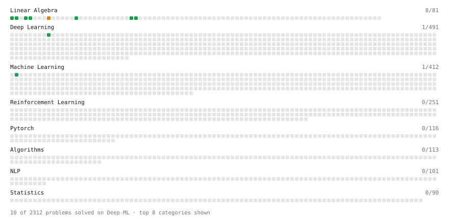

# Deep-ML

My machine learning practice from [Deep-ML](https://www.deep-ml.com). Every solution here was written by hand.

**28** solved · 25 problems · 0 labs · 3 math

[**Browse the interactive portfolio**](https://SanjeevAmbalam.github.io/deep-ml/) to replay this filling in over time.

## Problems

| | Difficulty | Solved | |
| --- | --- | --- | --- |
| [Backward Pass of Tanh Using Cached Output](https://www.deep-ml.com/problems/999) | easy | 2026-11-14 | [solution](problems/0999-backward-pass-of-tanh-using-cached-output) |
| [Calculate 2x2 Matrix Inverse](https://www.deep-ml.com/problems/8) | easy | 2026-02-11 | [solution](problems/0008-calculate-2x2-matrix-inverse) |
| [Calculate Cosine Similarity Between Vectors](https://www.deep-ml.com/problems/76) | easy | 2026-01-11 | [solution](problems/0076-calculate-cosine-similarity-between-vectors) |
| [Calculate Covariance Matrix](https://www.deep-ml.com/problems/10) | easy | 2026-02-14 | [solution](problems/0010-calculate-covariance-matrix) |
| [Calculate Mean by Row or Column](https://www.deep-ml.com/problems/4) | easy | 2026-01-11 | [solution](problems/0004-calculate-mean-by-row-or-column) |
| [Calculate Number of Parameters in Neural Network](https://www.deep-ml.com/problems/371) | easy | 2026-11-13 | [solution](problems/0371-calculate-number-of-parameters-in-neural-network) |
| [Compute a Gradient with PyTorch Autograd](https://www.deep-ml.com/problems/884) | easy | 2026-11-15 | [solution](problems/0884-compute-a-gradient-with-pytorch-autograd) |
| [Convert Vector to Diagonal Matrix](https://www.deep-ml.com/problems/35) | easy | 2026-01-11 | [solution](problems/0035-convert-vector-to-diagonal-matrix) |
| [Descriptive Statistics Calculator](https://www.deep-ml.com/problems/78) | easy | 2026-02-13 | [solution](problems/0078-descriptive-statistics-calculator) |
| [Dot Product Calculator](https://www.deep-ml.com/problems/83) | easy | 2026-01-11 | [solution](problems/0083-dot-product-calculator) |
| [Implement ReLU Activation Function](https://www.deep-ml.com/problems/42) | easy | 2026-01-11 | [solution](problems/0042-implement-relu-activation-function) |
| [Implement the Tanh Activation Function](https://www.deep-ml.com/problems/264) | easy | 2026-11-14 | [solution](problems/0264-implement-the-tanh-activation-function) |
| [Linear Regression Using Gradient Descent](https://www.deep-ml.com/problems/15) | easy | 2026-11-08 | [solution](problems/0015-linear-regression-using-gradient-descent) |
| [Matrix-Vector Dot Product](https://www.deep-ml.com/problems/1) | easy | 2026-01-11 | [solution](problems/0001-matrix-vector-dot-product) |
| [Poisson Distribution Probability Calculator](https://www.deep-ml.com/problems/81) | easy | 2026-02-11 | [solution](problems/0081-poisson-distribution-probability-calculator) |
| [Reshape Matrix](https://www.deep-ml.com/problems/3) | easy | 2026-11-13 | [solution](problems/0003-reshape-matrix) |
| [Scalar Multiplication of a Matrix](https://www.deep-ml.com/problems/5) | easy | 2026-01-11 | [solution](problems/0005-scalar-multiplication-of-a-matrix) |
| [Single Neuron](https://www.deep-ml.com/problems/24) | easy | 2026-11-13 | [solution](problems/0024-single-neuron) |
| [Transpose of a Matrix](https://www.deep-ml.com/problems/2) | easy | 2026-01-11 | [solution](problems/0002-transpose-of-a-matrix) |
| [Binomial Distribution Probability](https://www.deep-ml.com/problems/79) | medium | 2026-02-11 | [solution](problems/0079-binomial-distribution-probability) |
| [Calculate Eigenvalues of a Matrix](https://www.deep-ml.com/problems/6) | medium | 2026-02-11 | [solution](problems/0006-calculate-eigenvalues-of-a-matrix) |
| [Implementing Basic Autograd Operations](https://www.deep-ml.com/problems/26) | medium | 2026-11-14 | [solution](problems/0026-implementing-basic-autograd-operations) |
| [Matrix times Matrix ](https://www.deep-ml.com/problems/9) | medium | 2026-01-14 | [solution](problems/0009-matrix-times-matrix) |
| [Normal Distribution PDF Calculator](https://www.deep-ml.com/problems/80) | medium | 2026-02-11 | [solution](problems/0080-normal-distribution-pdf-calculator) |
| [Train a Tiny MLP on Your Value Engine](https://www.deep-ml.com/problems/1995) | medium | 2026-11-15 | [solution](problems/1995-train-a-tiny-mlp-on-your-value-engine) |

## Math

| | Difficulty | Solved | |
| --- | --- | --- | --- |
| [ML Workflow Basics](https://www.deep-ml.com/math-problems/30) | easy | 2026-11-08 | [solution](math/0030-ml-workflow-basics) |
| [Gradient of a Weight Shared Across Passes](https://www.deep-ml.com/math-problems/141) | medium | 2026-11-14 | [solution](math/0141-gradient-of-a-weight-shared-across-passes) |
| [Matrix Multiplication](https://www.deep-ml.com/math-problems/10) | medium | 2026-11-13 | [solution](math/0010-matrix-multiplication) |

---

_This file is regenerated by Deep-ML on every push._
